# MiMiYa 会员管理系统 🐝

> 一站式门店会员营销系统：**卡券 · 储值 · 计次 · 预约 · 积分**，帮实体门店沉淀会员、提升复购。


## 在线演示

| 端 | 地址 | 账号 | 密码 |
| --- | --- | --- | --- |
| 会员端 H5 | <http://47.101.60.127:8030/h5> | 手机号 18012345678 | 123456 |
| 后台管理 | <http://47.101.60.127:8033/> | mimiya | 123456 |

---
## 定制开发

如需基于本系统进行定制开发或部署，欢迎联系：**satnglove@gmail.com**

---
## 一、管理后台

### 登录 & 首页

账号密码登录，经营数据一屏看清。

| 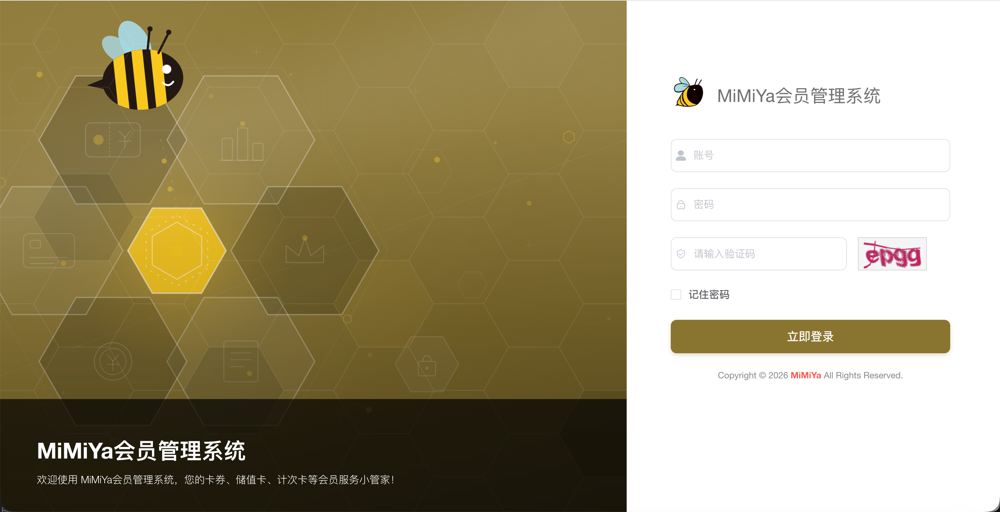 | 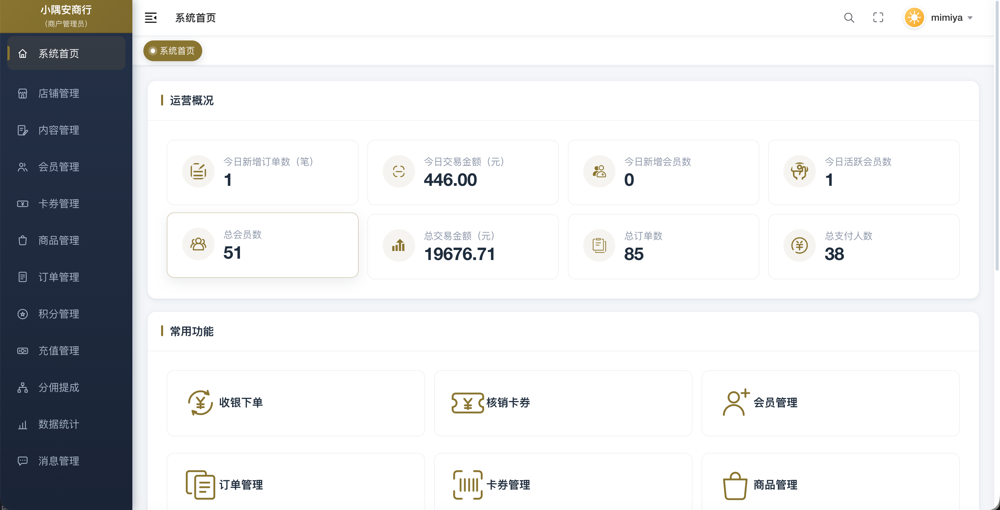 |
| --- | --- |
| 登录页 | 运营数据看板 + 常用功能入口 |

### 多门店管理

门店、员工、预约统一管理，支持门店二维码与默认店铺。

| 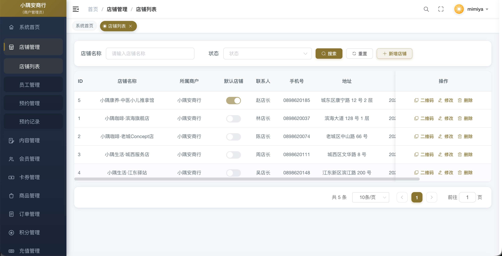 |
| --- |
| 店铺列表 |

### 会员管理

会员等级、余额、标签分组，支持批量导入导出。

| 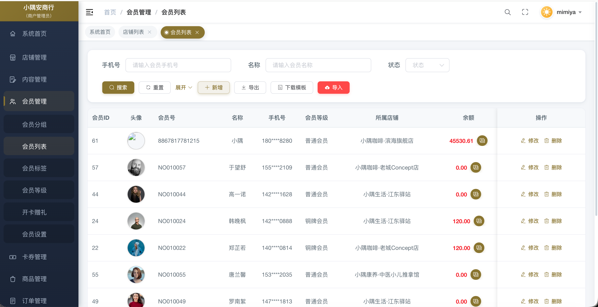 |
| --- |
| 会员列表 |

### 卡券 & 商品管理

储值卡、计次卡双类型，批量发券、核销、转赠全链路；商品含实物与虚拟卡券，库存盘点齐全。

### 订单 & 售后

商品/充值订单全流程，售后进度可视化。

| 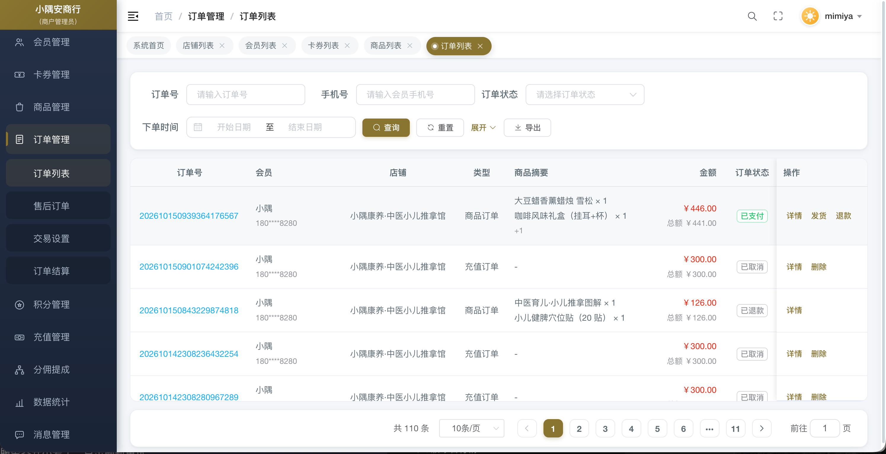 | 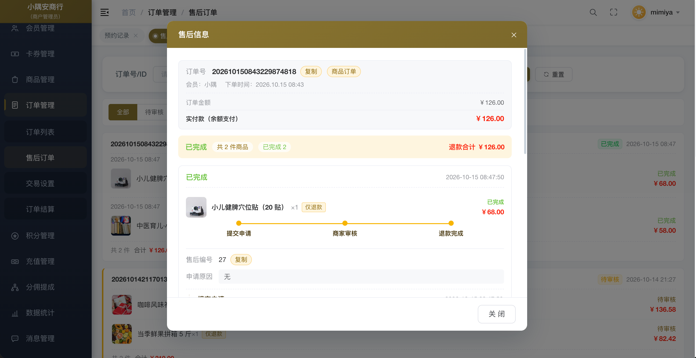 |
| --- | --- |
| 订单列表 | 售后详情：申请 → 审核 → 退款 |

---

## 二、会员端（H5 / 小程序）

### 首页 & 微店

切换门店、领券、充值、积分商品一站购齐。

|  |  |
| --- | --- |
| 首页 | 推荐商品 |
| 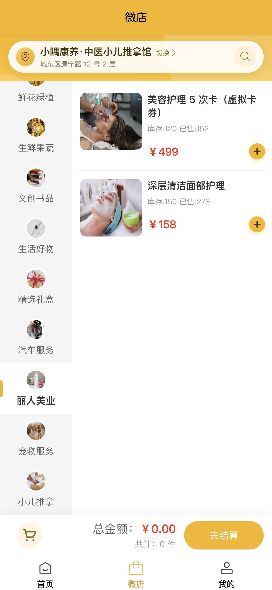 | 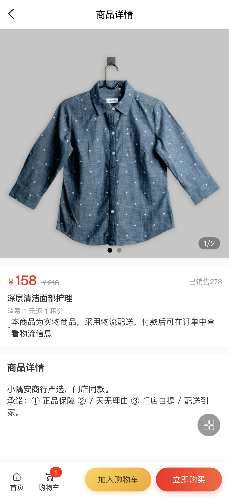 |
| 微店分类购物 | 商品详情 |

### 登录 & 会员中心

余额、积分、会员码，会员资产一目了然。

| 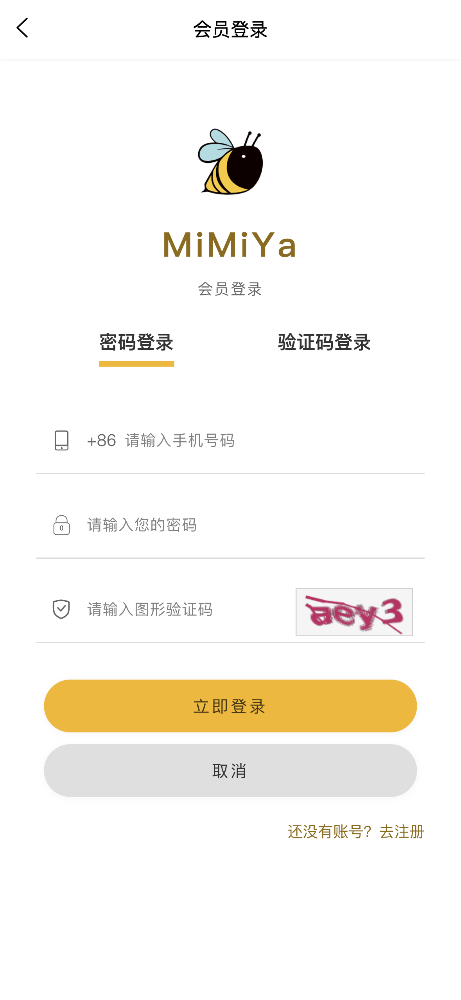 | 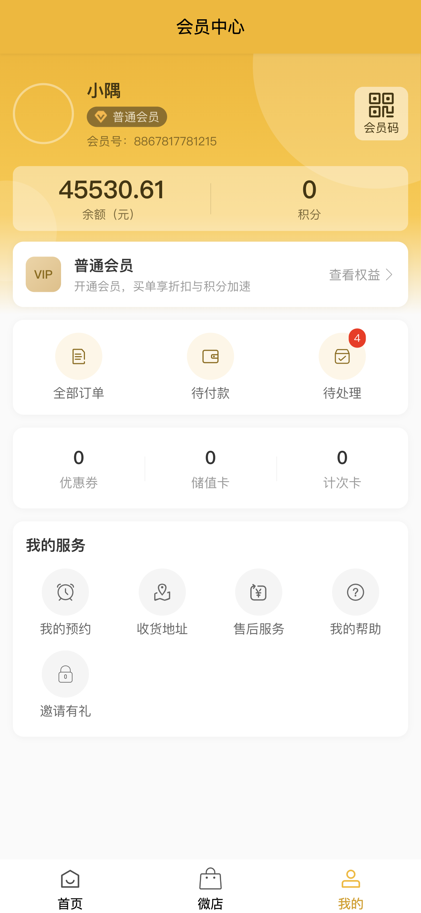 |
| --- | --- |
| 会员登录 | 会员中心 |

### 订单 & 售后

在线下单，售后进度随时查。

| 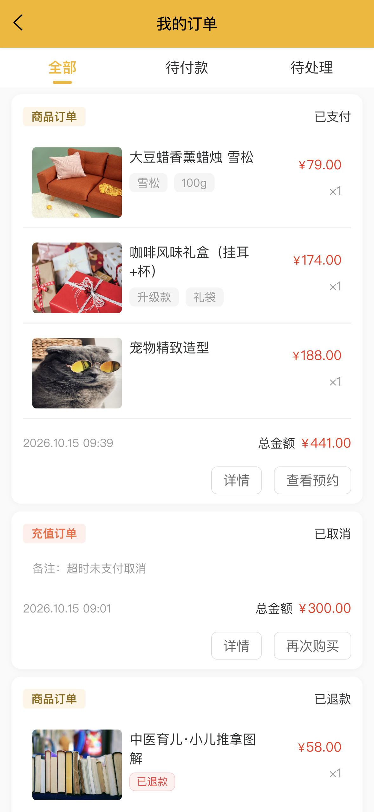 | 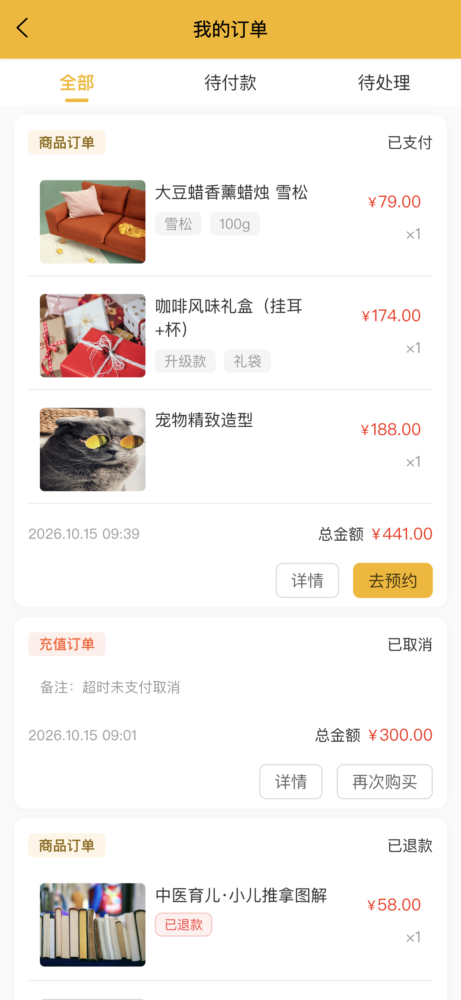 |
| --- | --- |
| 我的订单 | 去预约 / 再次购买 |
| 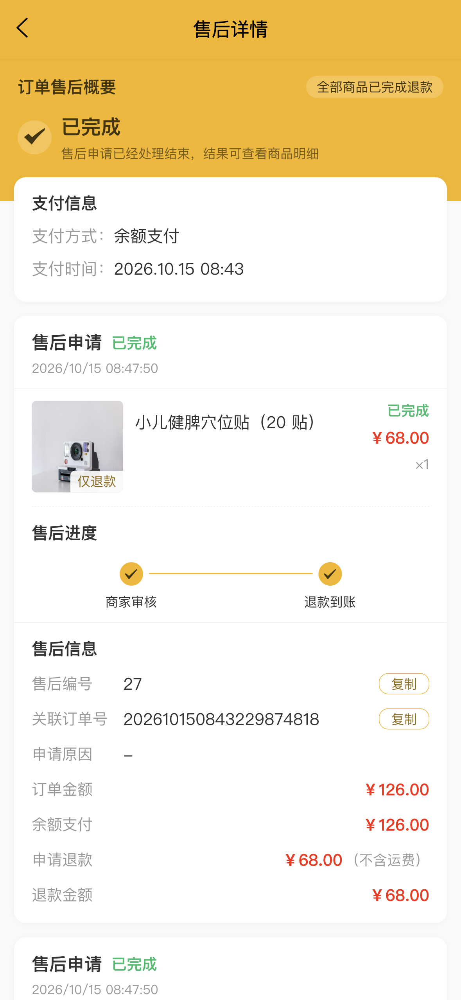 | 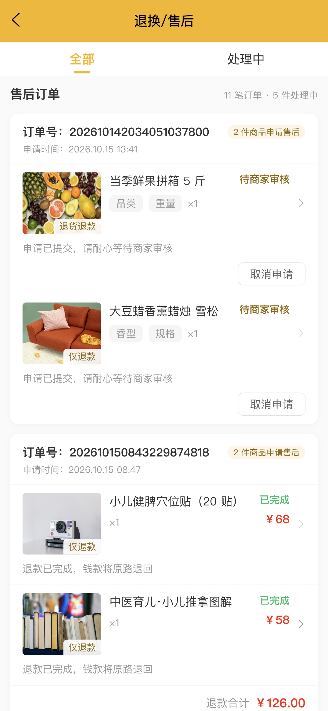 |
| 售后详情 | 售后列表 |

### 到店预约

选日期选时段，商家审核后按时到店。

| 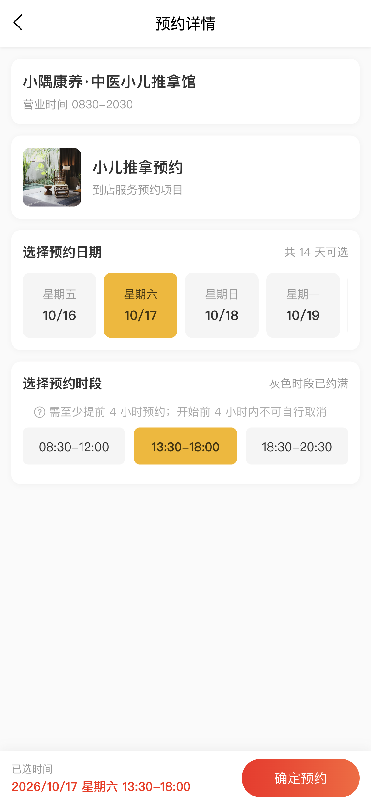 | 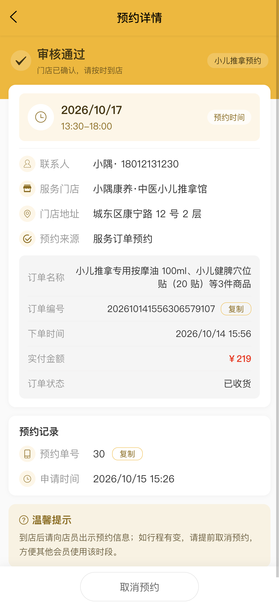 |
| --- | --- |
| 选择预约时间 | 预约审核通过 |

---

## 三、业务闭环

```
购卡/充值 → 到店预约 → 门店核销 → 攒积分 → 积分兑换/折扣复购
```

**产品亮点**：多门店 SaaS · 卡券体系完整 · 服务预约 · 会员资产可视化 · 售后闭环

---


